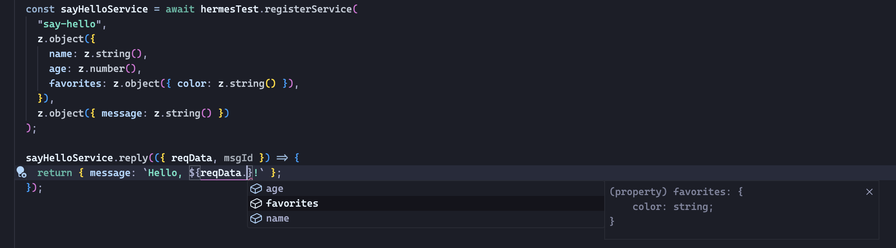
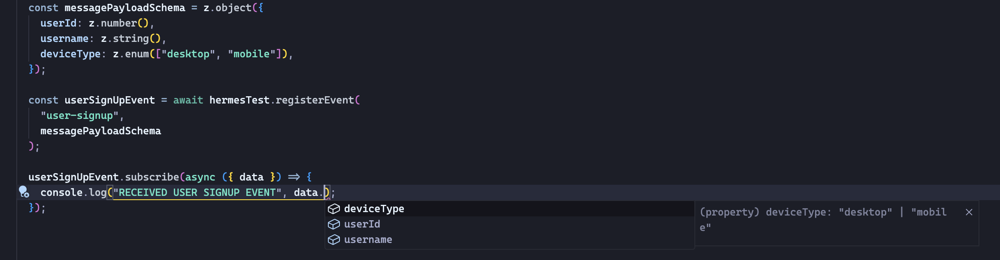

# Hermes

Type safe message bus, and "request-response" style services. Powered by Redis Streams

# Installation

```
pnpm add @swarnim/hermes
```

```
npm i @swarnim/hermes
```

# Features

- Type-safety
- Schema validation with [Zod](https://github.com/colinhacks/zod)
- Horizontally scalable
- Reliability
- Redis Streams do the heavy lifting
- consumers need to explicitly acknowledge that a message has been processed
- If (when) a consumer dies, all of the pending messages assigned to that consumer are transferred to another consumer after a timeout
- Retries with exponential backoff
  - Upto a configurable `maxRetries` number of times
  - Automatically triggered on failures

# Example

Type-Safe Service


Type-Safe Message Bus


# Usage

```ts
// Instantiate and connect to Hermes
const hermesTest = await Hermes({
  poolOptions: { min: 0, max: 20 },
  durableName: "playground",
  redisOptions: {
    host: process.env.REDIS_HOST || "0.0.0.0",
    port: Number(process.env.REDIS_PORT) || 6379,
    password: process.env.REDIS_PASSWORD || "",
  },
}).connect();

/** SERVICES **/

// Register a service
const sayHelloService = await hermesTest.registerService(
  "say-hello",
  z.object({
    name: z.string(),
    age: z.number(),
    favorites: z.object({ color: z.string() }),
  }),
  z.object({ message: z.string() })
);

// Register a reply handler for that service
sayHelloService.reply(({ reqData, msgId }) => {
  return { message: `Hello, ${reqData.name}!` };
});

// Make a request to that service, the reply handler should process it, and return a response
const response = await sayHelloService.request({
  name: "Swarnim",
  age: 12,
  favorites: { color: "Azure" },
});

// Print out the response
console.log("GOT_RESP", response);

/** MESSAGE BUS **/

// Register an event
const userSignUpEvent = await hermesTest.registerEvent(
  "user-signup",
  z.object({
    userId: z.number(),
    username: z.string(),
    deviceType: z.enum(["desktop", "mobile"]),
  })
);

// Register a subscriber handler to that event
userSignUpEvent.subscribe(async ({ data, msg }) => {
  console.log("RECEIVED USER SIGNUP EVENT", data);
  await msg.ack();
});

// Publish event, the subscriber handler should be invoked
await userSignUpEvent.publish({
  userId: 1,
  username: "testUser",
  deviceType: "desktop",
});

// ...

// During application teardown
await hermesTest.disconnect();
```

## Load Testing

Hermes includes a comprehensive load testing suite to help you evaluate performance and optimize your configuration.

### Quick Start

```bash
# Start Redis
npm run docker:redis

# Run all load tests
npm run load:all

# Or run specific test categories
npm run load:services  # RPC/Service load tests
npm run load:events    # Pub/Sub/Event load tests  
npm run load:mixed     # Mixed workload tests

# Run via Vitest (for CI/CD)
npm run test:load

# Real-time performance monitoring
npm run load:monitor
```

### Test Categories

- **Service Load Tests** - RPC request/response patterns under various loads
- **Event Load Tests** - Pub/sub message bus patterns with multiple subscribers
- **Mixed Workload Tests** - Combined service and event scenarios
- **Stress Tests** - High concurrency and volume scenarios
- **Endurance Tests** - Long-running stability tests
- **Error Recovery Tests** - Failure handling and retry mechanisms

### Performance Metrics

The load testing suite measures:
- **Throughput** (operations/second)
- **Latency** (average, P95, P99)
- **Error rates** and recovery
- **Memory usage** and growth
- **Resource utilization**

See [Load Testing Documentation](src/__tests__/load/README.md) for detailed information.

### Feature Ideas

- [ ] Job scheduler
- [ ] Better concurrency support
- [ ] Allow bulk publishing messages
  - [ ] With pipelining to optimize Redis calls and effective chunking
- [ ] Message de-duplication

---
# Contributing

This project follows the [all-contributors](https://allcontributors.org) specification.
Contributions of any kind are welcome!

## LICENSE

[MIT](LICENSE)